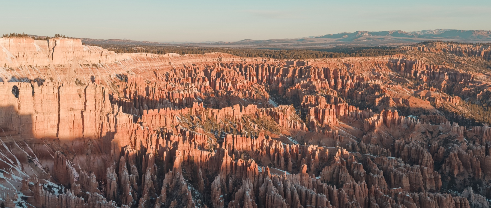
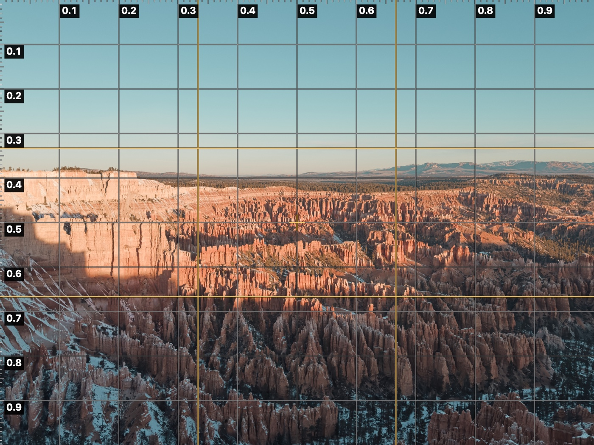
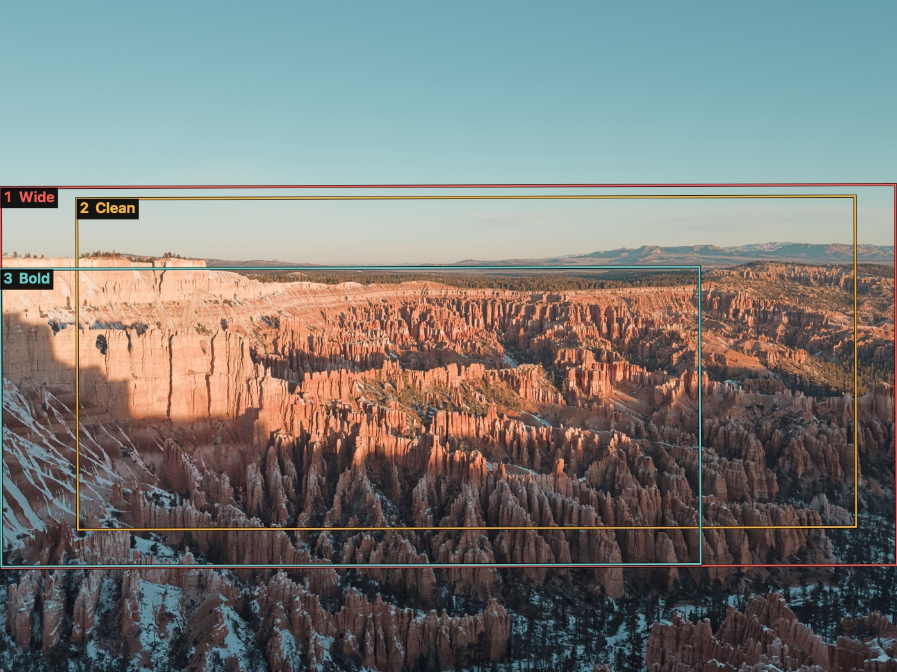
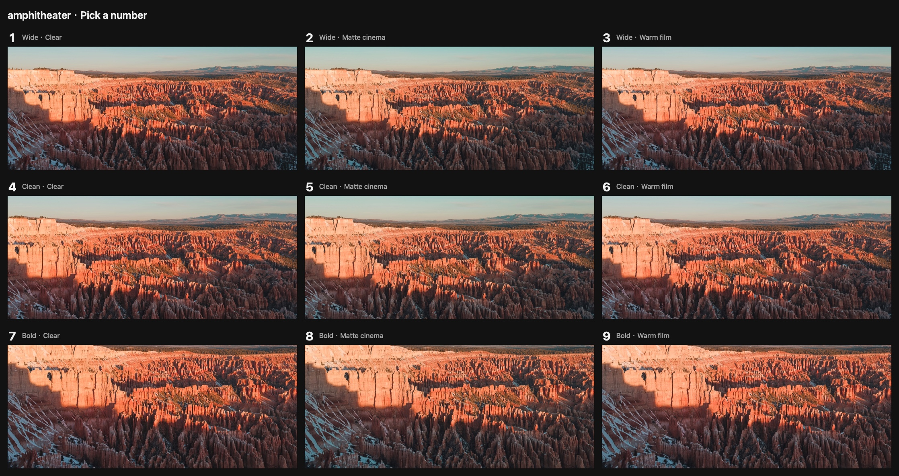
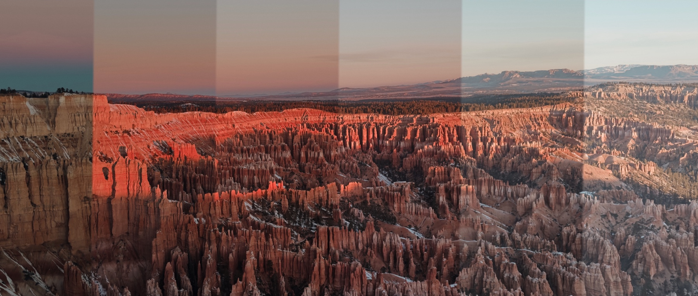

# cinema-grade

An agent skill that grades a set of photos to one consistent look and crops them to 2.35:1, driven headlessly through RapidRAW on macOS.

[](#requirements--defaults)
[](LICENSE)
[](https://github.com/sanhuang-qwq/cinema-grade/actions/workflows/ci.yml)



Give your vision-capable agent a folder of photos and a style direction. It normalizes exposure per photo, applies one shared style with guardrails, shows you a numbered 3×3 selection grid, and exports your pick as a native-resolution 16-bit Display P3 PNG.

## Quick Start

```sh
# 1. Install (pick one)
npx skills add sanhuang-qwq/cinema-grade

# Or as a Claude Code plugin:
# /plugin marketplace add sanhuang-qwq/cinema-grade
# /plugin install cinema-grade@cinema-grade

# Or symlink manually into ~/.claude/skills, ~/.gemini/config/skills, or ~/.codex/skills:
git clone https://github.com/sanhuang-qwq/cinema-grade.git
ln -s "$PWD/cinema-grade/skills/cinema-grade" ~/.claude/skills/cinema-grade

# 2. Verify macOS, swiftc auto-compile, and RapidRAW discovery
python3 scripts/batch_render.py --doctor
```

Then ask your agent in plain language:

> Grade the photos in `~/Pictures/trip` with `us_west_cinema_matte` and give me 2.35:1 crops to choose from.

## Workflow (One Photo, Start to Finish)

| 1. Measure (`--prep-rulers`) | 2. Self-check (`--preview-boxes`) |
| :---: | :---: |
|  |  |
| Reads subject position (±0.01) & horizon tilt off a 10×10 grid | Draws 3 rotated crops (wide / clean / bold) to reject bad cuts before rendering |

| 3. Pick by number (`3×3` grid) | 4. Export final (`--pick amphitheater=5`) |
| :---: | :---: |
|  |  |
| 3 crops × 3 subtle color variants; reply with a number `1–9` | Re-renders RAW → 16-bit TIFF → native 16-bit Display P3 PNG with EXIF |

## Why cinema-grade

- **Visual self-check instead of blind cropping.** Vision models measure real coordinates on `--prep-rulers` and inspect rotated crop frames on `--preview-boxes` before rendering.
- **Separated layers with guardrails.** Exposure stays in per-photo `base`; look stays locked in one shared `style`. The linter blocks exposure leakage, stacked green casts, and grain > 9.
- **True 16-bit Display P3 finals.** Previews are fast JPEGs; picked finals run through a lossless 16-bit pipeline at native resolution, preserving EXIF (capture time, camera, lens; `Orientation` reset to 1) unless stripped.
- **Zero third-party dependencies.** Pure Python standard library + one self-compiling Swift helper (`~/.cache/cinema-grade/`). Originals are strictly read-only.

## Built-in Styles

| Style | Status | Look |
| :--- | :---: | :--- |
| `jp_warm_cream_cyan` | Verified | Creamy warm highlights, cyan-blue skies, muted olive-gray foliage, soft lifted blacks |
| `us_west_cinema_matte` | Verified | Dense color, deep steel-cyan skies, terracotta red rock, velvet matte black floor |
| `nordic_overcast_slate` | Experimental | Cool slate blues, desaturated foliage, crisp neutral highlights |
| `noir_silver_mono` | Experimental | Silver-gelatin monochrome, S-curve with lifted matte black floor, fine grain |
| `night_tungsten_teal` | Experimental | Amber tungsten highlights, deep teal-blue shadows, gentle highlight roll-off |
| `warm_editorial_portrait` | Experimental | Skin-safe warm film, luminous oranges/reds, zero shadow green cast |



*Consistency across a full shoot: six sunrise frames normalized per shot, graded with one locked style layer, and stitched into a 2.35:1 time-slice composite. Experimental styles pass `--lint-styles` as starting points; see [CONTRIBUTING.md](CONTRIBUTING.md) to add styles from RapidRAW `.rrdata` sidecars.*

## Requirements & Defaults

- **macOS only** (Apple Silicon or Intel), **Xcode Command Line Tools** (`xcode-select --install`), **Python 3.9+**, **[RapidRAW](https://github.com/CyberTimon/RapidRAW) ≥ 1.7.1**, and a vision-capable agent.
- **Non-sandboxed GPU required:** RapidRAW's CLI uses Metal GPU and writes nothing inside a sandboxed shell.
- **Framing presets:** Borderless `2.35:1` (`canvas_aspect: "none"`) by default; optional black canvas presets `iphone` (`2868:1320`), `16x9`, `4x5`, `1x1`, or any custom ratio.
- **Full docs:** [`SKILL.md`](skills/cinema-grade/SKILL.md) (complete CLI reference & workflow), [`plan.example.json`](skills/cinema-grade/references/plan.example.json), and [`rapidraw_schema.md`](skills/cinema-grade/references/rapidraw_schema.md).

## License

[MIT](LICENSE) © 2026 sanhuang-qwq. RapidRAW is a separate project under its own license and is not bundled.
